<div align="center">


# Fennoly

**Your family's documents, in one private place.**

A self-hosted family drive that is simple enough for everyone at home: store, find, share and back up the papers that matter, on a computer you own.

[](LICENSE)


[Website](https://noorshikalgar.github.io/fennoly/) · [Features](#features) · [Install](#install) · [Backups](docs/BACKUPS.md) · [Development](docs/DEVELOPMENT.md)

<br>

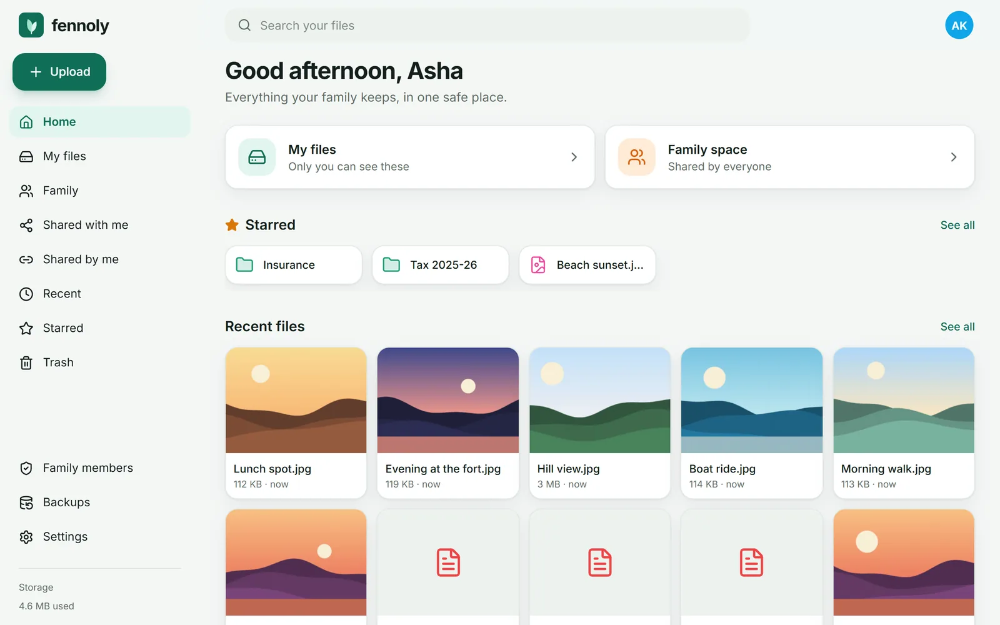

</div>

## Why Fennoly

Every family has a pile of important papers: ID cards, insurance policies, tax returns, school reports, property papers, medical records. Today they are scattered across phones, chat threads, email attachments and old pen drives. When you need one, you search everywhere, and when a phone is lost, so is everything on it.

The usual answers each fall short for this job:

- **Public cloud drives** put your family's most sensitive documents on someone else's servers, behind a monthly bill.
- **Self-hosted suites** can do everything, which makes them heavy to run and confusing for parents and grandparents.
- **Document-archive tools** are built for people who like tagging and workflows, not for a family that just wants to find the ration card.

Fennoly does one thing: keep a family's documents safe, organised and easy to reach. It runs on a small home server or an old PC, speaks the family's language, works well on phones, and keeps your files as ordinary folders on disk, so you can always walk away with them. No subscriptions, no telemetry, no tracking, 100% open source.

## Features

### Files and folders
- **My files** for each person (private) and a **Family space** everyone can use.
- Folders, rename, move, star, search, **Recent** and **Starred** views.
- **Trash** with restore; items are deleted for good after 30 days (configurable).
- Download many files or whole folders as a **zip**.
- Files are stored as **plain folders on disk** with their real names: no lock-in, no database blobs.

### Fast, unbreakable uploads
- Drag and drop files or **whole folders**, or use the Upload button.
- Large files go up in **parallel chunks**, each checked with a BLAKE3 hash.
- Uploads **survive bad networks**: a dropped Wi-Fi, a switch to mobile data or minutes offline, and they pick up where they stopped. They even resume after a page reload or a server restart.
- Up to 50 GB per file by default (configurable).

### Viewing
- Built-in viewer for **photos, PDFs, videos, audio and text**, with swipe between files on phones.
- Thumbnails for photos, generated on the server.

### Sharing
- Share with family members as **Can view** or **Can edit**.
- **Public links** for anyone else: optional **password**, **expiry date**, and **download on/off**, with view and download counts.
- **Shared with me** and **Shared by me** pages to see who has what.

### Built-in tools
- **Compress photos and PDFs** with a live before/after size preview, then save as a copy or replace the original.

### Backups and restore
- Automatic, scheduled backups to a **USB drive or folder**, a **NAS / Windows share (SMB)**, an **SFTP server**, or **S3 cloud storage** (Backblaze B2, Wasabi, Cloudflare R2, MinIO, AWS).
- **Encrypted** by default, with a recovery key you can print or save.
- Only changes are stored after the first backup; old backups are thinned out automatically (keeps 7 daily, 4 weekly, 12 monthly by default).
- Each backup includes the database, so everything can be rebuilt on a new machine.
- **Restore** any file or folder from any backup into a new folder; nothing is overwritten.
- A monthly health check re-reads part of the stored data, and admins are warned if backups stop working.
- Powered by [restic](https://restic.net) and [rclone](https://rclone.org). See [docs/BACKUPS.md](docs/BACKUPS.md).

### For the whole family
- **English, हिंदी and मराठी**, switchable at any time.
- **Light, Dark and Saffron** themes, or follow the device.
- Works on any phone, tablet or computer, and **installs like an app** (PWA).
- Admins add members, reset passwords, set **storage limits** and disable accounts.

### Private and secure
- Runs on **your hardware**; nothing is sent anywhere else.
- Passwords hashed with Argon2; repeated wrong passwords are locked out for longer and longer.
- Uploaded files can never run code in the app, and the web app ships a strict Content-Security-Policy.
- Backup passwords and keys are stored encrypted.
- Tested with an attacker's mindset: [`scripts/pentest.sh`](scripts/pentest.sh) runs 138 checks (access to other people's files, public links, uploads, sessions, injection and more).

## Screenshots

| | |
| --- | --- |
| 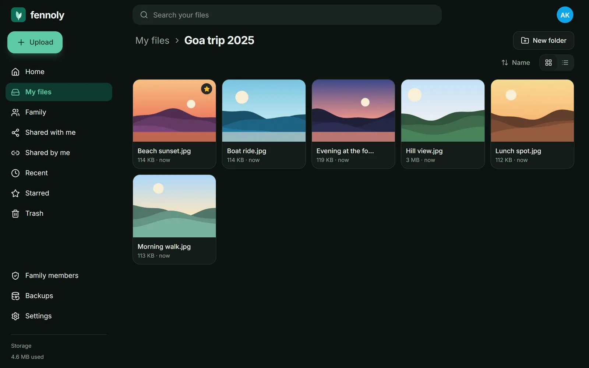 | 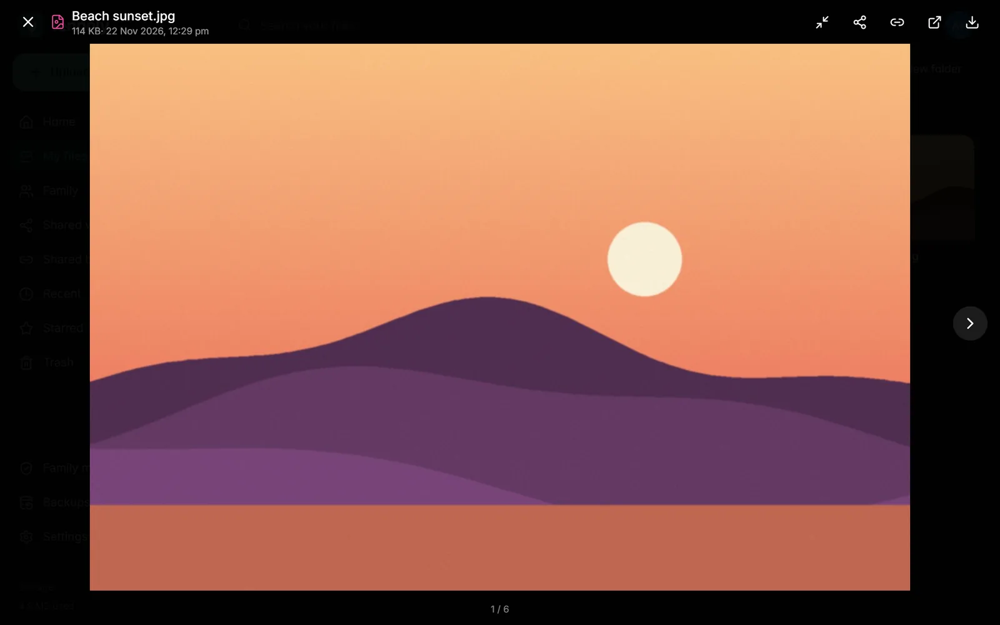 |
| Photos in the dark theme | Built-in viewer |
| 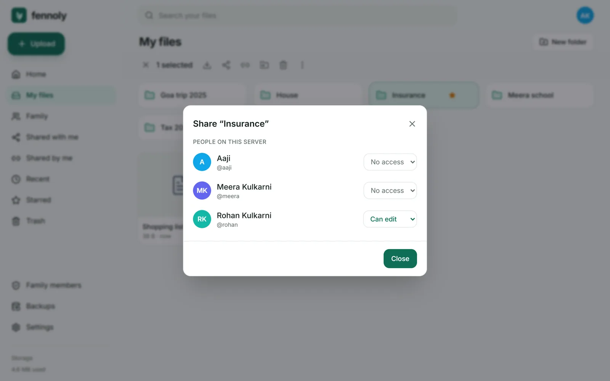 | 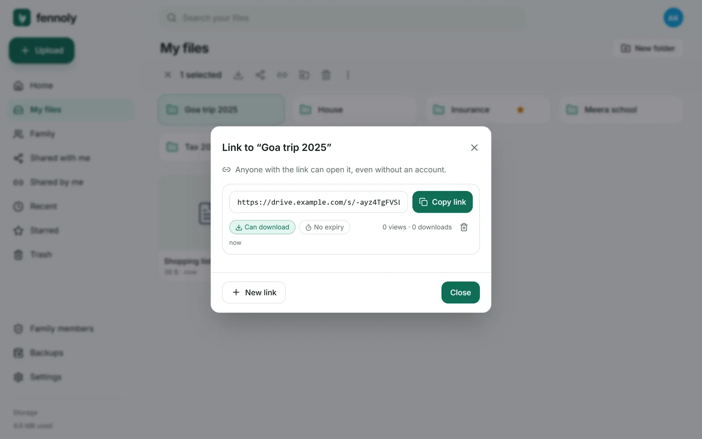 |
| Share with family members | Public links |
| 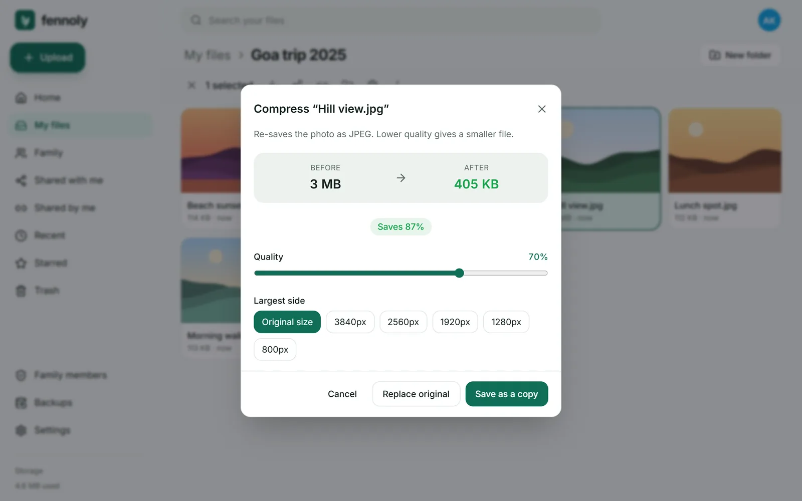 | 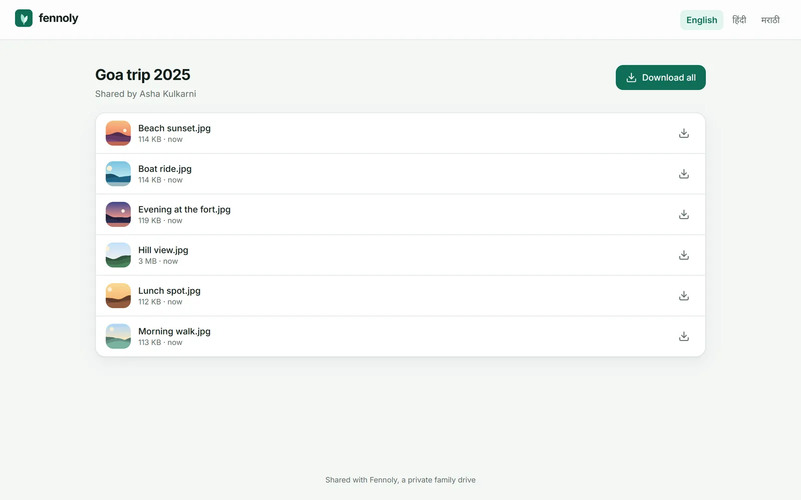 |
| Compress with a live preview | What a link visitor sees |
| 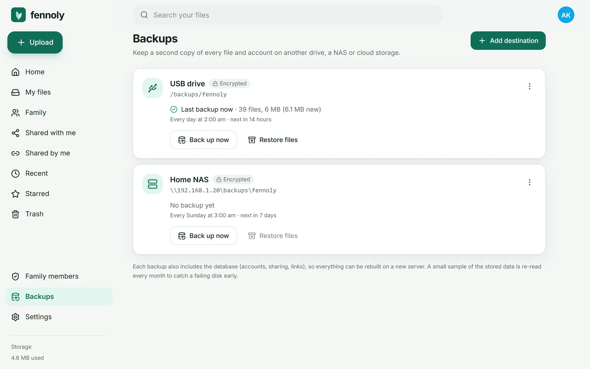 | 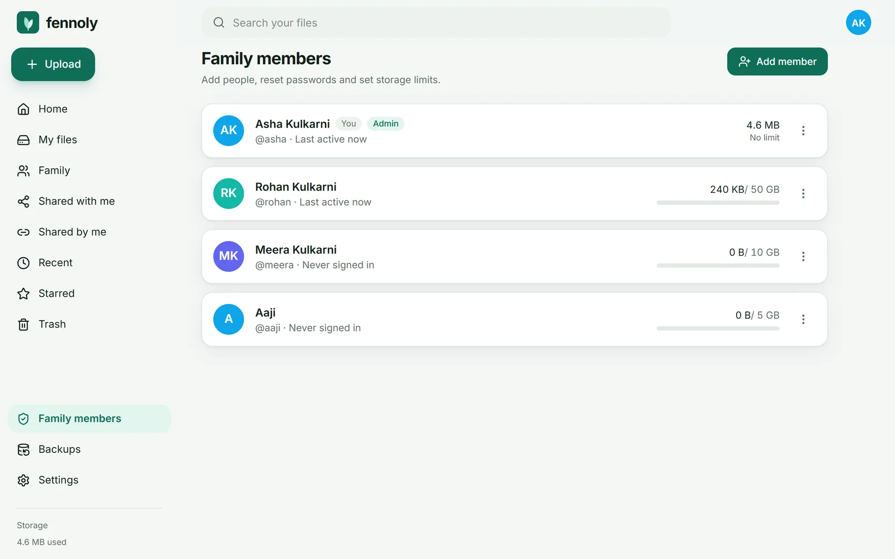 |
| Backups | Family members and storage limits |
| 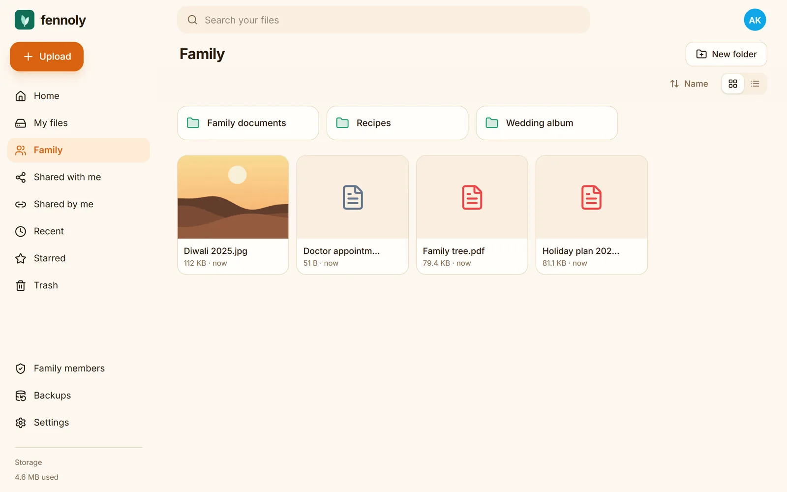 | 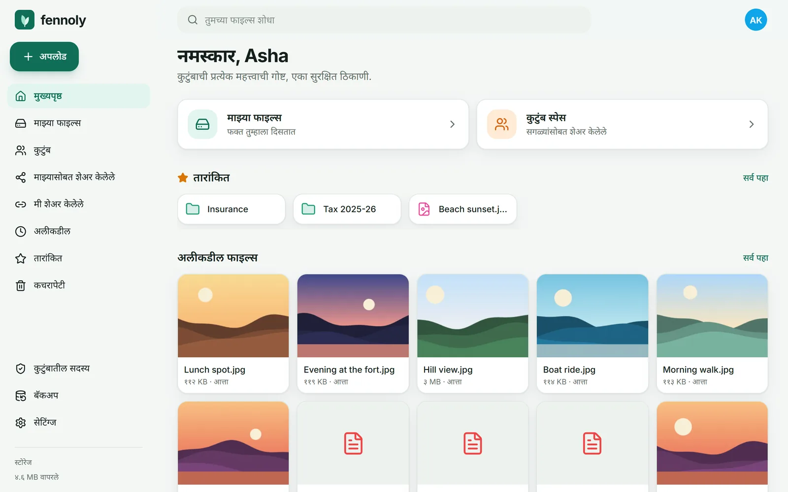 |
| Family space, Saffron theme | मराठी |

<div align="center">
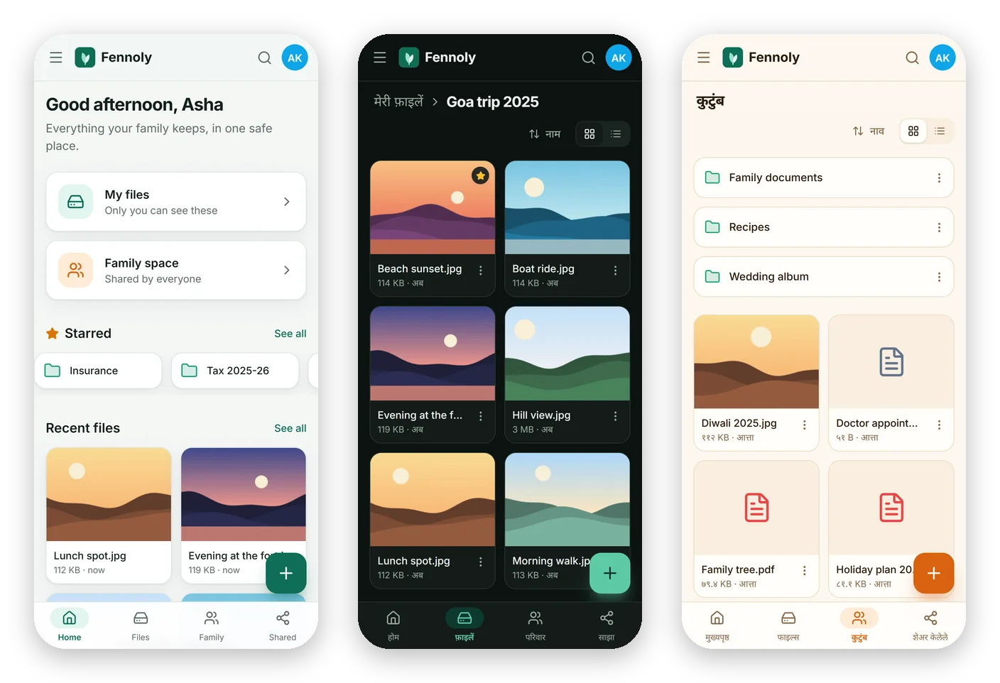
<br><sub>On phones: English · हिंदी · मराठी, in Light, Dark and Saffron</sub>
</div>

<sub>All names, files and photos in these screenshots are made up.</sub>

## Install

You need a computer that stays on (a home server, a NAS that runs Docker, a mini PC or an old laptop) with [Docker](https://docs.docker.com/get-docker/).

```bash
git clone https://github.com/noorshikalgar/fennoly.git
cd fennoly
# Edit deploy/docker-compose.yml: change POSTGRES_PASSWORD (in both places) and TZ.
docker compose -f deploy/docker-compose.yml up -d --build
```

Open `http://<your-server-ip>:8686` and create the first account; it becomes the admin. Then add your family under **Family members**, and set up **Backups**.

To reach Fennoly from outside your home, put it behind HTTPS (for example [Caddy](https://caddyserver.com)) or a VPN such as [Tailscale](https://tailscale.com), and set `FENNOLY_SECURE_COOKIES=true`.

## Built with

| Part | Technology |
| --- | --- |
| Server | Rust: Axum, Tokio, SQLx, PostgreSQL |
| Web app | SvelteKit, Svelte 5, TypeScript, Tailwind CSS, PWA |
| Uploads | Own chunked, resumable protocol with BLAKE3 (see [docs/UPLOADS.md](docs/UPLOADS.md)) |
| Tools | `image` crate (photos), Ghostscript (PDF) |
| Backups | restic, rclone, pg_dump |
| Deploy | One Docker image + PostgreSQL |

```
crates/
  fennoly-core     domain types, permission rules, safe names
  fennoly-tus      tus 1.0 upload protocol
  fennoly-tools    compress and convert engines
  fennoly-server   HTTP API, auth, storage, sharing, backups
web/               SvelteKit PWA
deploy/            Dockerfile and Docker Compose files
docs/              guides and the project website
scripts/           smoke, backup drill, pen test and screenshot scripts
```

## Status

Fennoly is young (v0.1) and under active development. It is tested end to end (uploads under bad networks, a real backup and restore drill, a pen test), but set up backups and expect changes before 1.0. Planned next: Google Drive and OneDrive backups, full restore from the setup screen, OCR search inside scanned documents, and a desktop app.

## Contributing

Issues and pull requests are welcome. Start with [docs/DEVELOPMENT.md](docs/DEVELOPMENT.md); it explains the sandbox server and test scripts, so you never test against real data.

## Licence

[GNU AGPL-3.0](LICENSE). You can use, study, change and share Fennoly freely; if you offer a changed version to others over a network, share your changes too.
